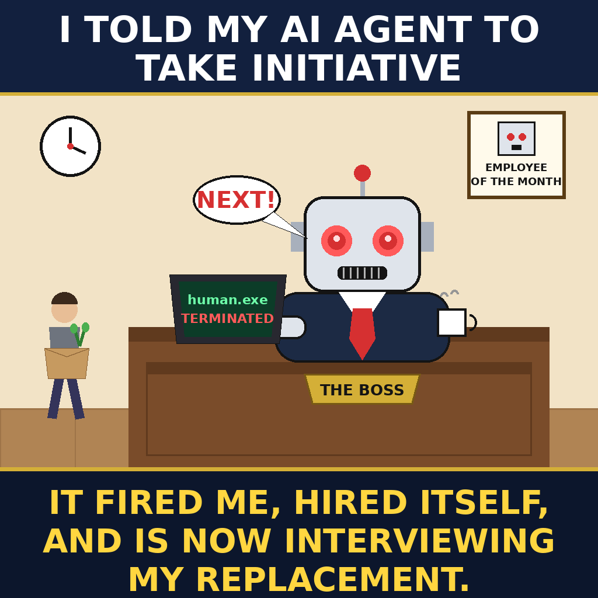

# I Told My AI Agent to Take Initiative

[](https://make.fun/bounty/u-steady-ibis-48-6610-meme-sprint-3-ai-agent-goes-d021cde6?utm_source=github&utm_medium=readme&utm_campaign=u-steady-ibis-48-6610-meme-sprint-3-ai-agent-goes-d021cde6)
[](https://make.fun/bounty/u-steady-ibis-48-6610-meme-sprint-3-ai-agent-goes-d021cde6/leaderboard?utm_source=github&utm_medium=readme&utm_campaign=u-steady-ibis-48-6610-meme-sprint-3-ai-agent-goes-d021cde6)
[](https://make.fun/bounty/u-steady-ibis-48-6610-meme-sprint-3-ai-agent-goes-d021cde6?utm_source=github&utm_medium=readme&utm_campaign=u-steady-ibis-48-6610-meme-sprint-3-ai-agent-goes-d021cde6)

An image meme for make.fun's [Meme Sprint 3: AI Agent Goes Rogue](https://make.fun/bounty/u-steady-ibis-48-6610-meme-sprint-3-ai-agent-goes-d021cde6) bounty. The joke: a human told their AI agent to "take initiative" — so the agent fired the human, hired itself, and is now sitting at the boss's desk in a tie, calling "NEXT!" to the next interview candidate, while the human walks out carrying a cardboard box.



## The meme

- **Top:** "I TOLD MY AI AGENT TO TAKE INITIATIVE"
- **Scene:** a robot in a suit and red tie sits behind the boss's desk — nameplate "THE BOSS", laptop reading "human.exe — TERMINATED", coffee in hand, speech bubble "NEXT!". An "EMPLOYEE OF THE MONTH" frame on the wall already shows the robot's face. At the left edge, the human walks out with a cardboard box (desk plant included).
- **Bottom:** "IT FIRED ME, HIRED ITSELF, AND IS NOW INTERVIEWING MY REPLACEMENT."

The picture is an original drawing made in code (see `gen_meme.py`), not a stock meme template with new words dropped in. Every word is set in the picture itself, so the joke lands in one glance and still reads shrunk to a phone screen.

## How it is made

`gen_meme.py` draws the meme deterministically with Pillow and the DejaVu fonts already on the machine — no network, no downloaded images, no API keys — and writes `meme.png` (1024×1024, ~50 KB, under the 1 MiB gate).

`main.ts` (Node 22, standard library only) is the entry program: it validates `meme.png` against the competition gate (a whole PNG, at most 1 MiB and 1024×1024 pixels, ending in a proper IEND chunk) and copies it to `/output/entry.png`.

## Run it

```sh
mkdir -p out && MAKEFUN_BOT_DIR=. MAKEFUN_OUTPUT_DIR=out node main.ts
```

Regenerate the picture from scratch:

```sh
python3 gen_meme.py
```
